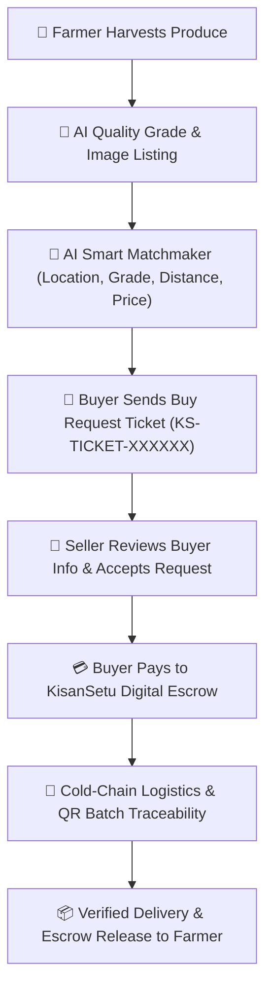
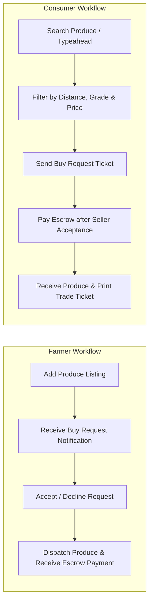

# KisanSetu AI — Smart India Hackathon (SIH) Complete Project Overview & Workflow Guide

> **Empowering Indian Agriculture Through AI Market Intelligence, Direct Farmer-to-Buyer Trade Contracts, Digital Escrow, and Transparent Supply Chain Traceability.**

---

## 📌 1. SIH Problem Statement & Core Challenge

### The Problem
Indian agriculture faces severe structural inefficiencies that reduce farmer incomes and inflate consumer prices:
1. **Middlemen Exploitation & Multi-layer Intermediaries**: Farmers often sell through 4 to 6 layers of commission agents (Arhtiyas/Middlemen), losing **25% to 35% of their potential income**.
2. **Distress Sales & Price Opacity**: Lack of real-time mandi price intelligence forces farmers to sell locally at unfavorable rates during peak harvest.
3. **High Post-Harvest Wastage**: Inefficient logistics routing and lack of cold-chain visibility cause up to **20% to 30% perishable crop wastage**.
4. **Lack of Trust & Fraud Risk**: Buyers face uncertain crop quality grades, while farmers fear delayed payments or bad debts from unverified buyers.

### The KisanSetu AI Solution
**KisanSetu AI** is a unified, end-to-end digital agricultural commerce and intelligence platform designed to:
- **Directly Connect Farmers with Buyers** (Retail Consumers, FPO Co-ops, and Bulk Supermarket Buyers).
- **Deliver AI Market Intelligence** (Mandi Optimizer, Price Recommendations, and Regional Demand Forecasts).
- **Enforce Fair Trade via Seller Acceptance & Escrow Protection** (No upfront payment before seller confirmation; funds held in escrow until delivery).
- **Generate Unified Digital Trade Tickets (`KS-TICKET-XXXXXX`)** with instant print/PDF support for both buyer and seller.
- **Provide QR Code Batch Traceability** from farm harvest to consumer delivery.

---

## 💡 2. Key Innovations & Unique Value Propositions

### 1. 🤖 AI Market Intelligence & Mandi Optimizer
- **Mandi Optimizer**: Analyzes prices across APMC mandis, transportation costs, and net realization to tell farmers *where and when to sell for maximum profit*.
- **AI Price Recommendation**: Recommends an optimal price range (Min–Max ₹/kg) based on live market supply index and regional demand predictions.
- **Demand Forecasting**: Predicts regional surplus and shortage hotspots (e.g., surplus in Karnal $\rightarrow$ shortage in Delhi NCR) to prevent wastage.

### 2. 🎯 AI Smart Consumer Matchmaking & Typeahead Search
- **Proximity & Distance Matching**: Uses Haversine distance algorithms to calculate exact distance (km) between farmer harvest location and consumer.
- **AI Match Score (0–100%)**: Dynamically ranks produce based on **Quality Score (40%)**, **Distance Proximity (30%)**, and **Price Value (30%)**.
- **Typeahead Autosuggest Search**: Typing 2–3 letters instantly displays live matching crops with thumbnail images, quality grades, district, and price.

### 3. 📩 Buy Request & Seller Approval Workflow
- **No Upfront Payment Required Initially**: Placing an order sends a formal **Buy Request** to the seller in `PENDING` status (*Awaiting Seller Acceptance*).
- **Seller Empowerment**: Farmers receive buyer registration details (Name, Phone, Email, Delivery Address, Requested Quantity) and can **Accept** or **Decline** the request.
- **Escrow Unlock**: Once the seller accepts, the **Pay & Confirm Escrow** button unlocks for the buyer.

### 4. 📄 Unified Trade Ticket & Printable Contract (`/ticket/:id`)
- **Shared Ticket ID**: Both buyer and seller share the exact same ticket ID (e.g., `KS-TICKET-849201`).
- **Complete Details**: Shows full registered contact info for both parties, item breakdown, quantities (kg), subtotal, logistics fee, platform fee, and grand total.
- **1-Click Print / PDF Export**: Built-in `Print Trade Ticket` button with print-optimized CSS for official trade documentation.

### 5. 🔍 QR Code Farm-to-Fork Batch Traceability
- **Batch QR Code**: Each harvest lot gets a unique QR payload (`KS-BATCH-XXXXXX`).
- **Stage-Wise Timeline**: Tracks listing, AI visual inspection, seller approval, logistics pickup, and consumer delivery.

---

## 🔄 3. Role-Based User Workflows

### 1. 🌾 Farmer / Producer Workflow
1. **List Produce**: Enters crop name, quantity (kg), price per kg, grade, harvest date, and upload photos.
2. **Receive Buy Request**: Gets an instant notification with Buyer Name, Phone Number, Location, and Requested Quantity.
3. **Accept or Decline**: Clicks **Accept** on the Farmer Dashboard or Trade Ticket.
4. **Dispatch & Get Paid**: After consumer pays into Escrow, dispatches produce and receives funds upon delivery.

### 2. 🛒 Retail Consumer & Bulk Buyer Workflow
1. **Search & Filter**: Uses Typeahead search (e.g. typing "whe" shows Wheat options) and filters by **Max Distance (km)**, **Quality Grade (Grade A/B/C)**, and **Price Range (₹)**.
2. **Submit Buy Request**: Selects custom quantity (e.g. 500 kg) using `+`, `-`, or typing directly in the input box, then clicks **Send Buy Request to Seller**.
3. **Track Status**: Views order ticket (`KS-TICKET-XXXXXX`) in **My Orders** (`/consumer/orders`).
4. **Pay & Confirm Escrow**: Once seller accepts, clicks **Pay & Confirm Escrow**.
5. **Print Trade Ticket**: Clicks **Print Trade Ticket** for record-keeping.

### 3. 🚚 Logistics Partner Workflow
1. **View Pickup Requests**: Sees accepted orders awaiting pickup in the Logistics Hub (`/logistics/dashboard`).
2. **Update Status**: Scans QR code or updates status to `IN_TRANSIT` and `DELIVERED`.

### 4. 🏛️ Admin Workflow
1. **System Overview**: Monitors total traded volume (kg), total revenue (₹), middleman savings (28%), and wastage reduction (22%).
2. **Regional Alerts**: Reviews surplus and shortage hotspots across districts.

---

## 📊 4. System Architecture & Tech Stack

| Component | Technology / Implementation |
| :--- | :--- |
| **Frontend Framework** | React.js (Vite), Tailwind CSS, Lucide Icons, React Router DOM |
| **Backend API** | Node.js, Express.js, RESTful Endpoints |
| **Database** | MongoDB with Mongoose Schemas (User, ProduceListing, Order, BatchTraceability) |
| **Authentication** | JWT (JSON Web Tokens) with Role-Based Access Control (RBAC) |
| **Location & Distance** | Haversine Formula for real-time kilometer proximity calculation |
| **AI Algorithms** | Computer Vision Quality Estimate, Dynamic AI Match Score (0–100%), Price Recommendation |
| **Document Export** | Print-optimized CSS (`@media print`) for instant PDF export of Trade Tickets |

---

## 🎯 5. SIH Presentation Pitch Summary (Quick Talking Points)

When presenting KisanSetu AI to judges:
1. **Problem Statement**: *"We address agricultural distress sales and 30% middleman losses by replacing informal deals with AI intelligence and transparent direct contracts."*
2. **Core Innovation**: *"Our platform features an AI Matchmaker combining location distance, crop grade, and price, paired with a seller-approval workflow where payment is unlocked only after mutual agreement."*
3. **Financial Protection**: *"Every transaction generates a shared digital Trade Ticket with print support and is protected by KisanSetu Digital Escrow."*
4. **Scalability**: *"Strictly uses real database listings with zero mock data, fully prepared for national APMC and e-NAM integration."*

---

> **Document Version**: 2.0 (SIH Final Verified Build)  
> **Repository File**: `DOCS/KisanSetu_SIH_Project_Overview.md`  
